# Endless

**English** · [ภาษาไทย](README.th.md)

Endless is a bilingual sales assistant for Thai shops that sell through chat. The app brings customer conversations into a shared inbox and uses each shop’s catalog and knowledge to answer questions.

## Watch Endless in action

[Open the narrated-by-presenter slide deck (5 min 45 sec)](https://endless-shop-pitch-2026.ratha-tart.chatgpt.site/). Press **Play** to follow the demo or open the Thai speaker notes to rehearse it.

**A customer asks about a game.** May asks “How much is Ticket to Ride: USA?” The shop replies in English with the catalog price of 1,490 baht and confirms availability. May switches to Thai to ask when the shop opens. The reply gives the daily hours, 10:00–20:00 Thailand time. [Watch the production chat recording](docs/pitch/recordings/customer.mp4).

[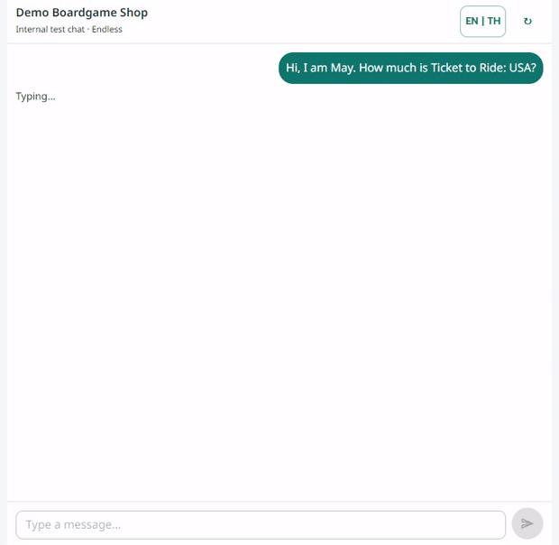](docs/pitch/recordings/customer.mp4)

**A shopkeeper takes over.** In a separately recorded production Inbox session, the owner selects **Take over**, sees the conversation assigned to staff, sends a reply, and returns control to the AI. [Watch the production handoff recording](docs/pitch/recordings/handoff.mp4).

[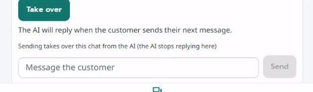](docs/pitch/recordings/handoff.mp4)

**How the shop improves its answers.** A missing fact is a reason to bring in a person. The merchant can check the product, approve a product-specific FAQ and make that knowledge available for retrieval. The pitch uses an English rulebook as an illustrative example. The production clips above show the price, hours and staff controls.

**Prepare an order for dispatch.** In the demo shop, staff open the packing sheet, review a shipment deadline and open its shipping details. Recipient fields are masked.

[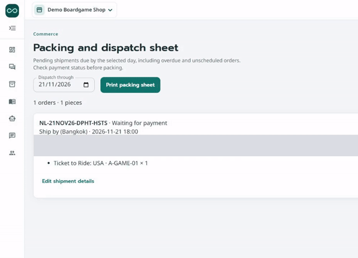](docs/pitch/recordings/packing.mp4)

## Feature viewing guide

Use the recordings below to follow the release snapshot feature by feature. The product recordings above show the running application. Each **evidence walkthrough** below shows the feature’s repository record and its documented scope. For an unimplemented feature, the walkthrough covers the design only. The release ledger below gives the recorded mode for every entry.

| Feature | Walkthrough | Source |
|---|---|---|
| F01 · Application foundation | [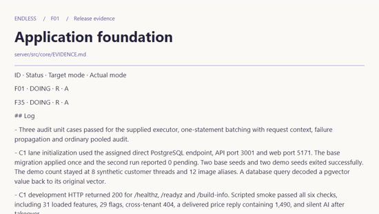](docs/pitch/recordings/f01.mp4)<br>[Evidence walkthrough](docs/pitch/recordings/f01.mp4) | [Feature record](server/src/core/EVIDENCE.md) |
| F02 · Account sign-in and recovery | [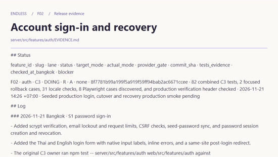](docs/pitch/recordings/f02.mp4)<br>[Evidence walkthrough](docs/pitch/recordings/f02.mp4) | [Feature record](server/src/features/auth/EVIDENCE.md) |
| F03 · Shops, invitations and permissions | [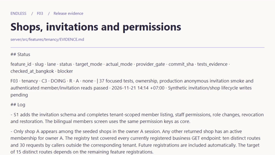](docs/pitch/recordings/f03.mp4)<br>[Evidence walkthrough](docs/pitch/recordings/f03.mp4) | [Feature record](server/src/features/tenancy/EVIDENCE.md) |
| F04 · Shop settings and answer policies | [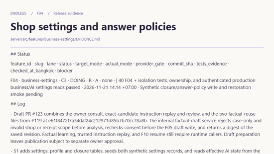](docs/pitch/recordings/f04.mp4)<br>[Evidence walkthrough](docs/pitch/recordings/f04.mp4) | [Feature record](server/src/features/business-settings/EVIDENCE.md) |
| F05 · Merchant knowledge and FAQs | [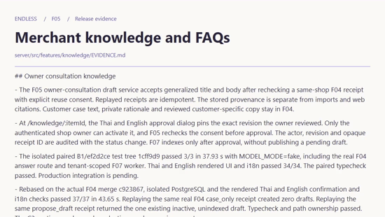](docs/pitch/recordings/f05.mp4)<br>[Evidence walkthrough](docs/pitch/recordings/f05.mp4) | [Feature record](server/src/features/knowledge/EVIDENCE.md) |
| F06 · Knowledge imports | [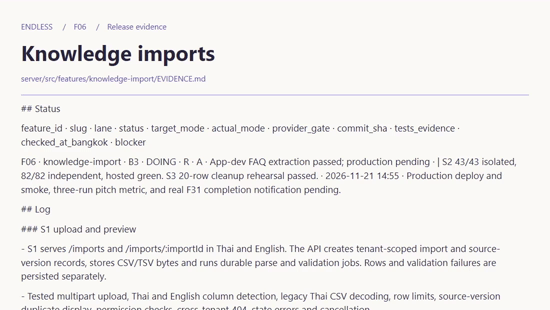](docs/pitch/recordings/f06.mp4)<br>[Evidence walkthrough](docs/pitch/recordings/f06.mp4) | [Feature record](server/src/features/knowledge-import/EVIDENCE.md) |
| F07 · Knowledge retrieval and evaluation | [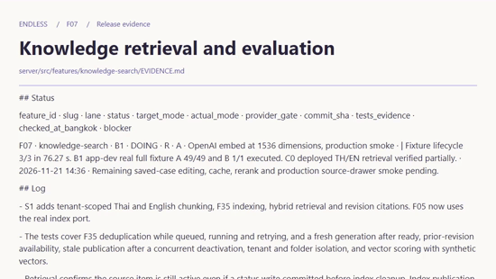](docs/pitch/recordings/f07.mp4)<br>[Evidence walkthrough](docs/pitch/recordings/f07.mp4) | [Feature record](server/src/features/knowledge-search/EVIDENCE.md) |
| F08 · Product catalog and variants | [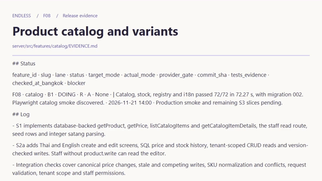](docs/pitch/recordings/f08.mp4)<br>[Evidence walkthrough](docs/pitch/recordings/f08.mp4) | [Feature record](server/src/features/catalog/EVIDENCE.md) |
| F09 · Shared conversation inbox | [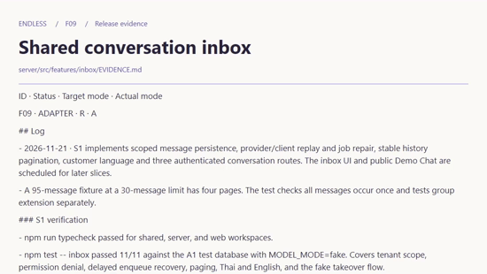](docs/pitch/recordings/f09.mp4)<br>[Evidence walkthrough](docs/pitch/recordings/f09.mp4) | [Feature record](server/src/features/inbox/EVIDENCE.md) |
| F10 · AI replies and tool use | [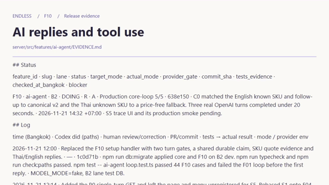](docs/pitch/recordings/f10.mp4)<br>[Evidence walkthrough](docs/pitch/recordings/f10.mp4) | [Feature record](server/src/features/ai-agent/EVIDENCE.md) |
| F11 · Staff takeover and handback | [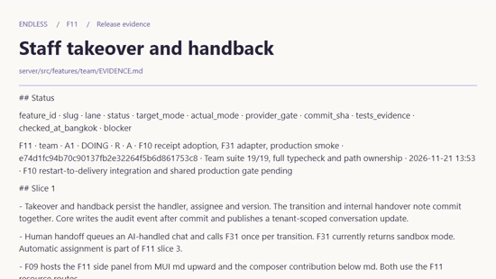](docs/pitch/recordings/f11.mp4)<br>[Evidence walkthrough](docs/pitch/recordings/f11.mp4) | [Feature record](server/src/features/team/EVIDENCE.md) |
| F12 · Message templates | [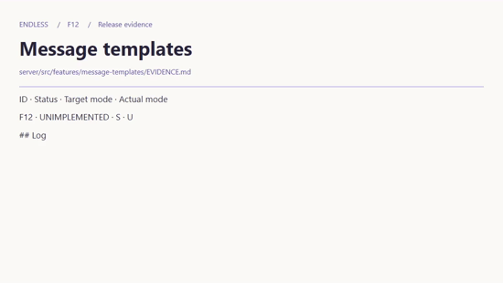](docs/pitch/recordings/f12.mp4)<br>[Design walkthrough](docs/pitch/recordings/f12.mp4) | [Feature record](server/src/features/message-templates/EVIDENCE.md) |
| F13 · Quotes and orders | [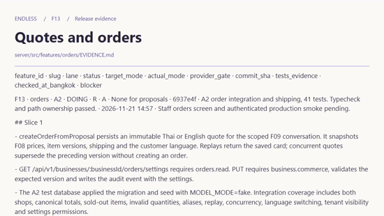](docs/pitch/recordings/f13.mp4)<br>[Evidence walkthrough](docs/pitch/recordings/f13.mp4) | [Feature record](server/src/features/orders/EVIDENCE.md) |
| F14 · Payments and slip checks | [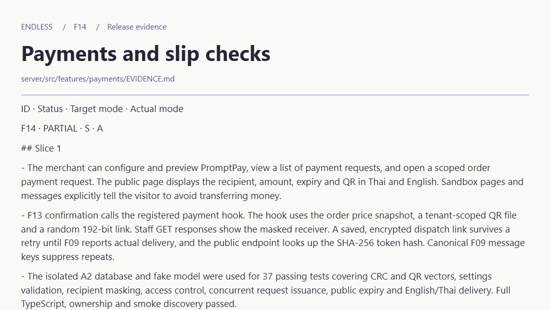](docs/pitch/recordings/f14.mp4)<br>[Evidence walkthrough](docs/pitch/recordings/f14.mp4) | [Feature record](server/src/features/payments/EVIDENCE.md) |
| F15 · Booking and reminders | [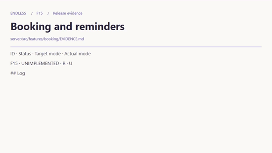](docs/pitch/recordings/f15.mp4)<br>[Design walkthrough](docs/pitch/recordings/f15.mp4) | [Feature record](server/src/features/booking/EVIDENCE.md) |
| F16 · Google Calendar | [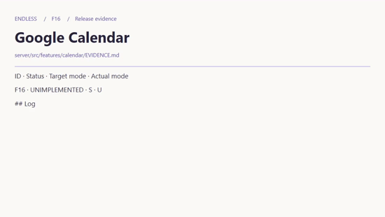](docs/pitch/recordings/f16.mp4)<br>[Design walkthrough](docs/pitch/recordings/f16.mp4) | [Feature record](server/src/features/calendar/EVIDENCE.md) |
| F17 · LINE Official Account | [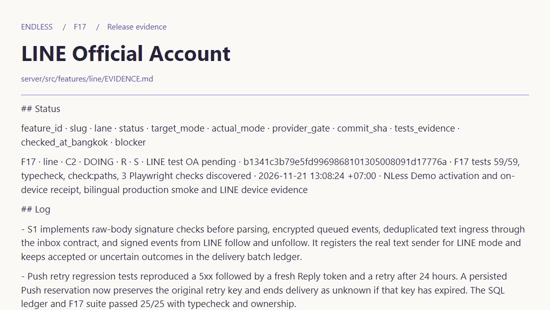](docs/pitch/recordings/f17.mp4)<br>[Evidence walkthrough](docs/pitch/recordings/f17.mp4) | [Feature record](server/src/features/line/EVIDENCE.md) |
| F18 · Facebook and Instagram | [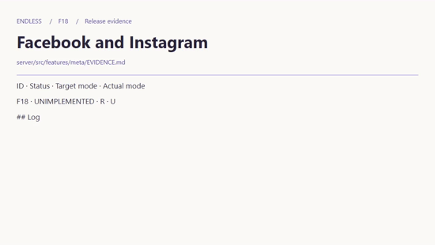](docs/pitch/recordings/f18.mp4)<br>[Design walkthrough](docs/pitch/recordings/f18.mp4) | [Feature record](server/src/features/meta/EVIDENCE.md) |
| F21 · Comment-to-message replies | [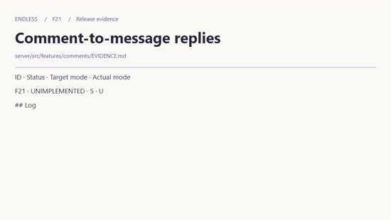](docs/pitch/recordings/f21.mp4)<br>[Design walkthrough](docs/pitch/recordings/f21.mp4) | [Feature record](server/src/features/comments/EVIDENCE.md) |
| F22 · Live-selling product codes | [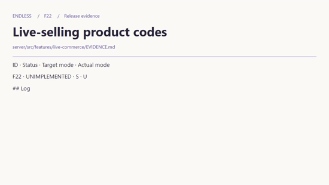](docs/pitch/recordings/f22.mp4)<br>[Design walkthrough](docs/pitch/recordings/f22.mp4) | [Feature record](server/src/features/live-commerce/EVIDENCE.md) |
| F23 · Customer broadcasts | [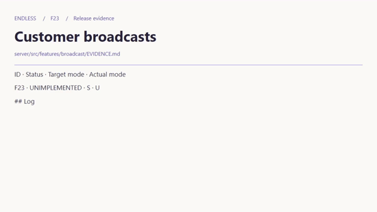](docs/pitch/recordings/f23.mp4)<br>[Design walkthrough](docs/pitch/recordings/f23.mp4) | [Feature record](server/src/features/broadcast/EVIDENCE.md) |
| F24 · Customer profiles and tags | [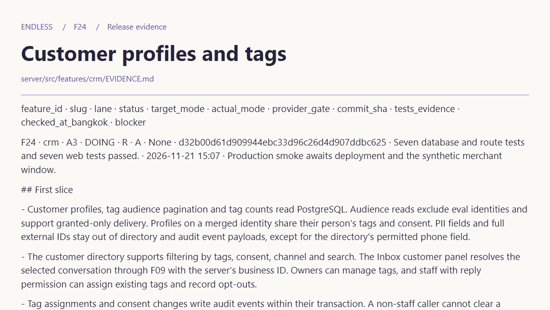](docs/pitch/recordings/f24.mp4)<br>[Evidence walkthrough](docs/pitch/recordings/f24.mp4) | [Feature record](server/src/features/crm/EVIDENCE.md) |
| F26 · Shop insights | [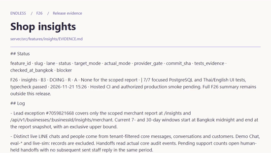](docs/pitch/recordings/f26.mp4)<br>[Design walkthrough](docs/pitch/recordings/f26.mp4) | [Feature record](server/src/features/insights/EVIDENCE.md) |
| F27 · Usage and cost reporting | [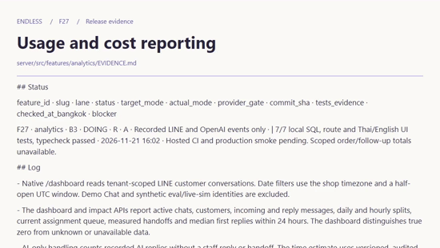](docs/pitch/recordings/f27.mp4)<br>[Design walkthrough](docs/pitch/recordings/f27.mp4) | [Feature record](server/src/features/analytics/EVIDENCE.md) |
| F30 · Voice conversations | [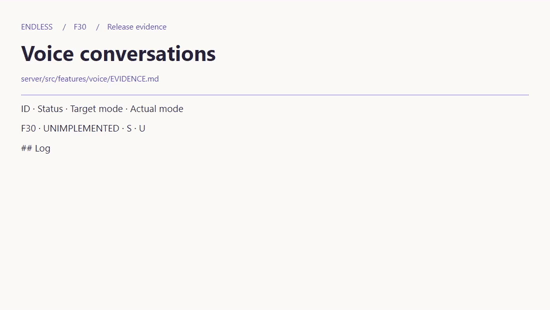](docs/pitch/recordings/f30.mp4)<br>[Design walkthrough](docs/pitch/recordings/f30.mp4) | [Feature record](server/src/features/voice/EVIDENCE.md) |
| F31 · Staff notifications | [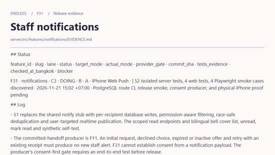](docs/pitch/recordings/f31.mp4)<br>[Evidence walkthrough](docs/pitch/recordings/f31.mp4) | [Feature record](server/src/features/notifications/EVIDENCE.md) |
| F35 · Background jobs and reliability | [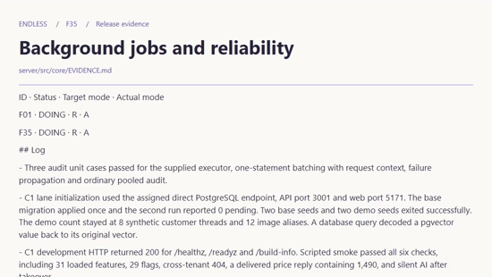](docs/pitch/recordings/f35.mp4)<br>[Evidence walkthrough](docs/pitch/recordings/f35.mp4) | [Feature record](server/src/core/EVIDENCE.md) |
| F36 · Release verification | [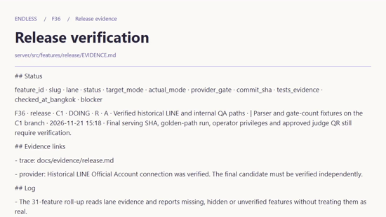](docs/pitch/recordings/f36.mp4)<br>[Evidence walkthrough](docs/pitch/recordings/f36.mp4) | [Feature record](server/src/features/release/EVIDENCE.md) |
| F37 · Model evaluations | [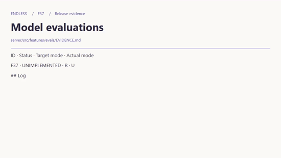](docs/pitch/recordings/f37.mp4)<br>[Design walkthrough](docs/pitch/recordings/f37.mp4) | [Feature record](server/src/features/evals/EVIDENCE.md) |
| F38 · Customer follow-ups | [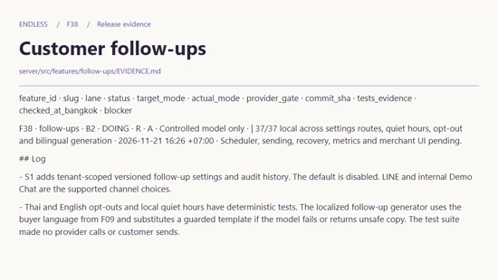](docs/pitch/recordings/f38.mp4)<br>[Design walkthrough](docs/pitch/recordings/f38.mp4) | [Feature record](server/src/features/follow-ups/EVIDENCE.md) |
| F39 · ChatGPT-ready catalog | [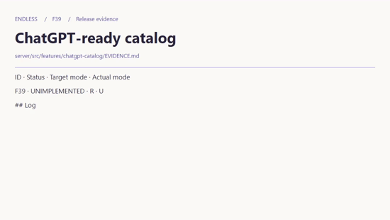](docs/pitch/recordings/f39.mp4)<br>[Design walkthrough](docs/pitch/recordings/f39.mp4) | [Feature record](server/src/features/chatgpt-catalog/EVIDENCE.md) |

## Development

Use Node.js 24. In your assigned worktree, run:

```sh
npm ci
npm run lane:init
npm run db:migrate
npm run db:seed
npm run dev
```

The lane initializer provisions the assigned local and test PostgreSQL databases. Keep workstation configuration in the machine-level secrets file described in the [setup prompt](prompts/C1-setup.md). In development, open the web URL for your lane and visit `/dev-login` to select a synthetic owner or staff account.

```sh
npm run typecheck
npm test
npm run smoke
npm run e2e -- core
```

See [the product brief](docs/PRODUCT.md), [the development cookbook](docs/COOKBOOK.md), and [deployment instructions](docs/day/deployment.md).

## Declared prior work

The baseline contains planning documents, feature specifications, type-only contract references, the team board script, and Codex session configuration. Application implementation for the event starts with the F01 setup branch. The repository uses synthetic fixtures for the demo and development tests.

## Release evidence

The customer and judge entry is the team LINE Official Account. The approved QR export is pending. Demo Chat is reserved for internal QA.

Evidence snapshot based on `926e5c09d7a723abe66adb5d532028b1cadece05`.

0 R · 1 S · 17 A · 13 U

| ID | Feature | Mode | Evidence |
|---|---|---|---|
| F01 | Application foundation | A | [Evidence](server/src/core/EVIDENCE.md) |
| F02 | Account sign-in and recovery | A | [Evidence](server/src/features/auth/EVIDENCE.md) |
| F03 | Shops, invitations and permissions | A | [Evidence](server/src/features/tenancy/EVIDENCE.md) |
| F04 | Shop settings and answer policies | A | [Evidence](server/src/features/business-settings/EVIDENCE.md) |
| F05 | Merchant knowledge and FAQs | A | [Evidence](server/src/features/knowledge/EVIDENCE.md) |
| F06 | Knowledge imports | A | [Evidence](server/src/features/knowledge-import/EVIDENCE.md) |
| F07 | Knowledge retrieval and evaluation | A | [Evidence](server/src/features/knowledge-search/EVIDENCE.md) |
| F08 | Product catalog and variants | A | [Evidence](server/src/features/catalog/EVIDENCE.md) |
| F09 | Shared conversation inbox | A | [Evidence](server/src/features/inbox/EVIDENCE.md) |
| F10 | AI replies and tool use | A | [Evidence](server/src/features/ai-agent/EVIDENCE.md) |
| F11 | Staff takeover and handback | A | [Evidence](server/src/features/team/EVIDENCE.md) |
| F12 | Message templates | U | [Evidence](server/src/features/message-templates/EVIDENCE.md) |
| F13 | Quotes and orders | A | [Evidence](server/src/features/orders/EVIDENCE.md) |
| F14 | Payments and slip checks | A | [Evidence](server/src/features/payments/EVIDENCE.md) |
| F15 | Booking and reminders | U | [Evidence](server/src/features/booking/EVIDENCE.md) |
| F16 | Google Calendar | U | [Evidence](server/src/features/calendar/EVIDENCE.md) |
| F17 | LINE Official Account | S | [Evidence](server/src/features/line/EVIDENCE.md) |
| F18 | Facebook and Instagram | U | [Evidence](server/src/features/meta/EVIDENCE.md) |
| F21 | Comment-to-message replies | U | [Evidence](server/src/features/comments/EVIDENCE.md) |
| F22 | Live-selling product codes | U | [Evidence](server/src/features/live-commerce/EVIDENCE.md) |
| F23 | Customer broadcasts | U | [Evidence](server/src/features/broadcast/EVIDENCE.md) |
| F24 | Customer profiles and tags | A | [Evidence](server/src/features/crm/EVIDENCE.md) |
| F26 | Shop insights | U | [Evidence](server/src/features/insights/EVIDENCE.md) |
| F27 | Usage and cost reporting | U | [Evidence](server/src/features/analytics/EVIDENCE.md) |
| F30 | Voice conversations | U | [Evidence](server/src/features/voice/EVIDENCE.md) |
| F31 | Staff notifications | A | [Evidence](server/src/features/notifications/EVIDENCE.md) |
| F35 | Background jobs and reliability | A | [Evidence](server/src/core/EVIDENCE.md) |
| F36 | Release verification | A | [Evidence](server/src/features/release/EVIDENCE.md) |
| F37 | Model evaluations | U | [Evidence](server/src/features/evals/EVIDENCE.md) |
| F38 | Customer follow-ups | U | [Evidence](server/src/features/follow-ups/EVIDENCE.md) |
| F39 | ChatGPT-ready catalog | U | [Evidence](server/src/features/chatgpt-catalog/EVIDENCE.md) |

R means Real, S means Sandbox, A means Adapter, and U means Unimplemented.

112 merged pull requests, 112 commits and 72249 added lines.
Candidate Vitest counts are unavailable.
Candidate golden-path counts are unavailable.

See the [feature ledger](docs/FEATURE_STATUS.csv), [production evidence](docs/evidence/release.md), [Codex timeline](docs/evidence/codex-timeline.md) and [submission checklist](docs/submission/SUBMISSION.md).
