# Endless

[English](README.md) · **ภาษาไทย**

Endless เป็นผู้ช่วยขายที่ตอบได้ทั้งไทยและอังกฤษสำหรับร้านค้าที่ขายผ่านแชท ทีมร้านเห็นบทสนทนาในกล่องข้อความเดียวกัน และ AI ใช้แค็ตตาล็อกกับคลังความรู้ของร้านนั้นเพื่อตอบลูกค้า

## ดู Endless ทำงานจริง

[เปิดสไลด์นำเสนอพร้อมเดโม (5 นาที 45 วินาที)](https://endless-shop-pitch-2026.ratha-tart.chatgpt.site/) กด **Play** เพื่อเริ่ม หรือกด **บทพูด** เพื่อซ้อมตามสคริปต์ภาษาไทย

**เมย์ถามราคาเกม** เมย์พิมพ์เป็นภาษาอังกฤษว่า “How much is Ticket to Ride: USA?” ร้านตอบกลับเป็นภาษาอังกฤษว่าราคา 1,490 บาทตามแค็ตตาล็อกและมีสินค้าพร้อมขาย จากนั้นเมย์ถามภาษาไทยในแชทเดิมว่าร้านเปิดกี่โมง ร้านตอบว่าเปิดทุกวัน 10:00–20:00 น. ตามเวลาไทย [ดูคลิปแชทจากระบบจริง](docs/pitch/recordings/customer.mp4)

[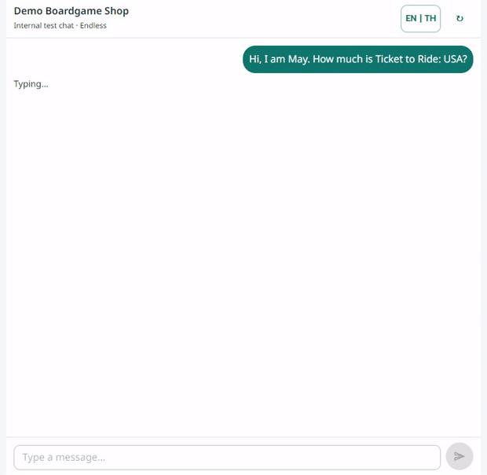](docs/pitch/recordings/customer.mp4)

**เจ้าของร้านรับช่วงตอบเอง** คลิปนี้บันทึกแยกจากฝั่ง Inbox บนระบบจริง เจ้าของกด **Take over** เห็นว่าแชทเปลี่ยนมาอยู่ในความดูแลของพนักงาน ส่งข้อความถึงลูกค้า แล้วคืนแชทให้ AI ดูแลต่อ [ดูคลิปการรับช่วง](docs/pitch/recordings/handoff.mp4)

[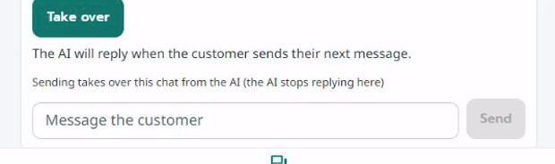](docs/pitch/recordings/handoff.mp4)

**ร้านปรับปรุงคำตอบได้อย่างไร** เมื่อข้อมูลยังไม่พอ เจ้าของร้านเข้ามาตรวจสินค้าและอนุมัติคำตอบสำหรับรุ่นนั้นเป็น FAQ ให้ระบบค้นมาใช้ในครั้งต่อไป ในสไลด์เราใช้คำถามเรื่องคู่มือภาษาอังกฤษเป็นตัวอย่าง ส่วนคลิปจากระบบจริงด้านบนแสดงการตอบราคา เวลาเปิดร้าน และการรับช่วงของพนักงาน

## เลือกดูคลิปตามฟีเจอร์

คลิปสองคลิปด้านบนแสดงการใช้งานจริง ส่วนคลิปในตารางด้านล่างพาดูหลักฐานและขอบเขตงานที่บันทึกไว้ใน repository ตามรุ่นที่ตรวจ สำหรับฟีเจอร์ที่ยังไม่พัฒนา คลิปจะแสดงเฉพาะแบบที่วางไว้ กดภาพเพื่อเปิดวิดีโอฉบับเต็ม และดูสถานะของแต่ละฟีเจอร์ได้ในตารางท้ายหน้า

| ฟีเจอร์ | คลิป | เอกสาร |
|---|---|---|
| F01 · ฐานโปรเจกต์และการรัน | [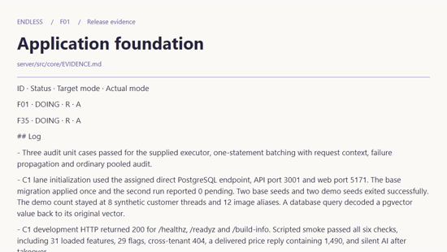](docs/pitch/recordings/f01.mp4)<br>[ดูหลักฐาน](docs/pitch/recordings/f01.mp4) | [บันทึกฟีเจอร์](server/src/core/EVIDENCE.md) |
| F02 · ตัวตนและ session | [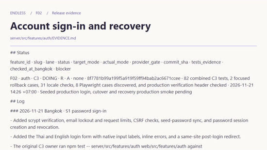](docs/pitch/recordings/f02.mp4)<br>[ดูหลักฐาน](docs/pitch/recordings/f02.mp4) | [บันทึกฟีเจอร์](server/src/features/auth/EVIDENCE.md) |
| F03 · บัญชี ธุรกิจ สมาชิก และสิทธิ์ | [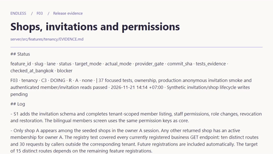](docs/pitch/recordings/f03.mp4)<br>[ดูหลักฐาน](docs/pitch/recordings/f03.mp4) | [บันทึกฟีเจอร์](server/src/features/tenancy/EVIDENCE.md) |
| F04 · การตั้งค่าธุรกิจ | [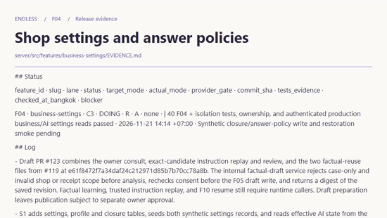](docs/pitch/recordings/f04.mp4)<br>[ดูหลักฐาน](docs/pitch/recordings/f04.mp4) | [บันทึกฟีเจอร์](server/src/features/business-settings/EVIDENCE.md) |
| F05 · คลังความรู้และวงจรข้อมูล | [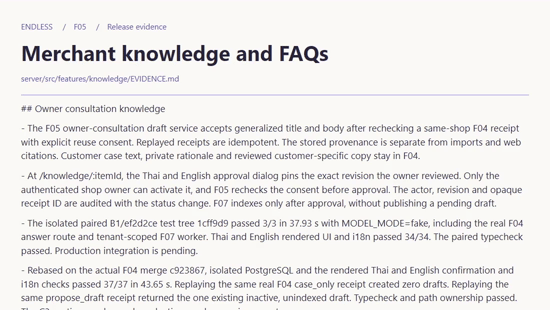](docs/pitch/recordings/f05.mp4)<br>[ดูหลักฐาน](docs/pitch/recordings/f05.mp4) | [บันทึกฟีเจอร์](server/src/features/knowledge/EVIDENCE.md) |
| F06 · นำเข้าและสกัดข้อมูล | [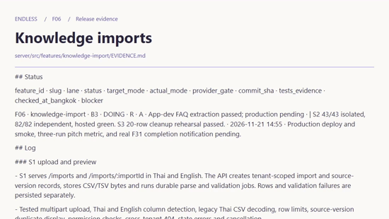](docs/pitch/recordings/f06.mp4)<br>[ดูหลักฐาน](docs/pitch/recordings/f06.mp4) | [บันทึกฟีเจอร์](server/src/features/knowledge-import/EVIDENCE.md) |
| F07 · ค้นคืน RAG และประเมิน revision | [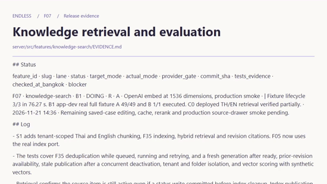](docs/pitch/recordings/f07.mp4)<br>[ดูหลักฐาน](docs/pitch/recordings/f07.mp4) | [บันทึกฟีเจอร์](server/src/features/knowledge-search/EVIDENCE.md) |
| F08 · Catalog สินค้า/บริการ/variants | [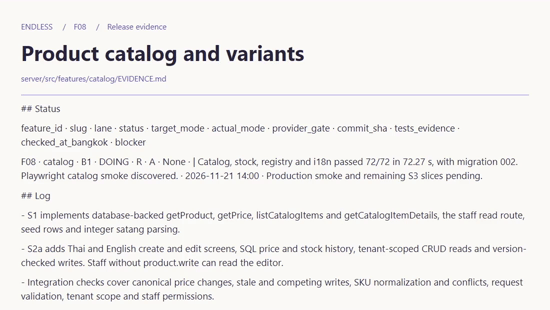](docs/pitch/recordings/f08.mp4)<br>[ดูหลักฐาน](docs/pitch/recordings/f08.mp4) | [บันทึกฟีเจอร์](server/src/features/catalog/EVIDENCE.md) |
| F09 · Inbox และประวัติ | [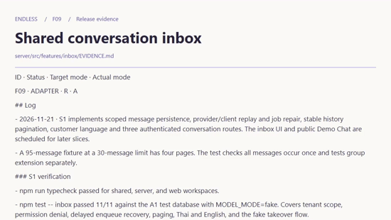](docs/pitch/recordings/f09.mp4)<br>[ดูหลักฐาน](docs/pitch/recordings/f09.mp4) | [บันทึกฟีเจอร์](server/src/features/inbox/EVIDENCE.md) |
| F10 · AI turn และเครื่องมือ | [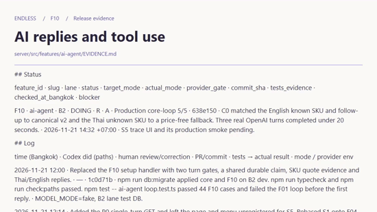](docs/pitch/recordings/f10.mp4)<br>[ดูหลักฐาน](docs/pitch/recordings/f10.mp4) | [บันทึกฟีเจอร์](server/src/features/ai-agent/EVIDENCE.md) |
| F11 · ทีมและ human handoff | [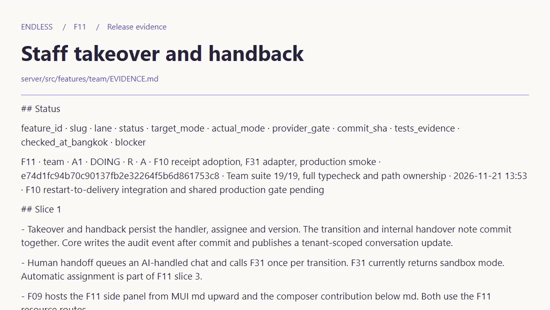](docs/pitch/recordings/f11.mp4)<br>[ดูหลักฐาน](docs/pitch/recordings/f11.mp4) | [บันทึกฟีเจอร์](server/src/features/team/EVIDENCE.md) |
| F12 · Rich messages และ templates | [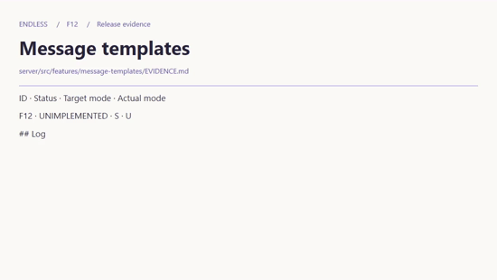](docs/pitch/recordings/f12.mp4)<br>[ดูแบบที่วางไว้](docs/pitch/recordings/f12.mp4) | [บันทึกฟีเจอร์](server/src/features/message-templates/EVIDENCE.md) |
| F13 · Commerce และ orders | [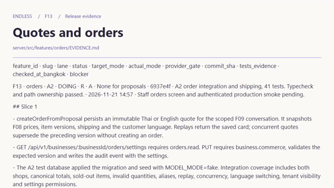](docs/pitch/recordings/f13.mp4)<br>[ดูหลักฐาน](docs/pitch/recordings/f13.mp4) | [บันทึกฟีเจอร์](server/src/features/orders/EVIDENCE.md) |
| F14 · QR การชำระและตรวจสลิป | [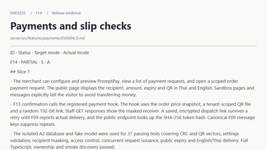](docs/pitch/recordings/f14.mp4)<br>[ดูหลักฐาน](docs/pitch/recordings/f14.mp4) | [บันทึกฟีเจอร์](server/src/features/payments/EVIDENCE.md) |
| F15 · Booking และ reminders | [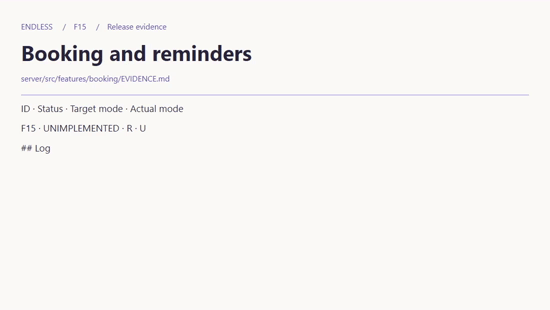](docs/pitch/recordings/f15.mp4)<br>[ดูแบบที่วางไว้](docs/pitch/recordings/f15.mp4) | [บันทึกฟีเจอร์](server/src/features/booking/EVIDENCE.md) |
| F16 · Google Calendar | [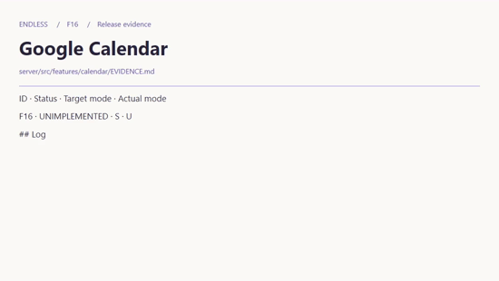](docs/pitch/recordings/f16.mp4)<br>[ดูแบบที่วางไว้](docs/pitch/recordings/f16.mp4) | [บันทึกฟีเจอร์](server/src/features/calendar/EVIDENCE.md) |
| F17 · LINE | [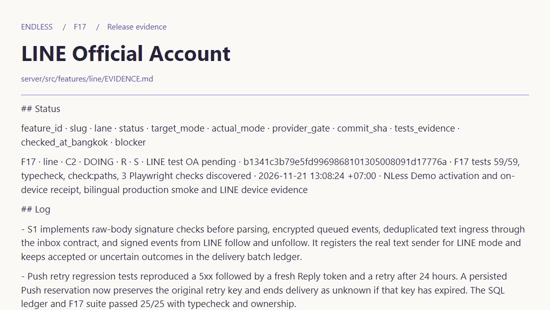](docs/pitch/recordings/f17.mp4)<br>[ดูหลักฐาน](docs/pitch/recordings/f17.mp4) | [บันทึกฟีเจอร์](server/src/features/line/EVIDENCE.md) |
| F18 · Facebook และ Instagram | [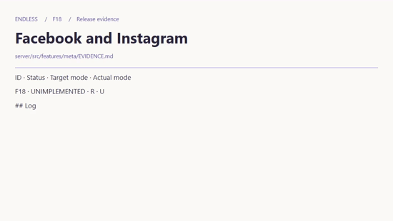](docs/pitch/recordings/f18.mp4)<br>[ดูแบบที่วางไว้](docs/pitch/recordings/f18.mp4) | [บันทึกฟีเจอร์](server/src/features/meta/EVIDENCE.md) |
| F21 · Comment-to-DM | [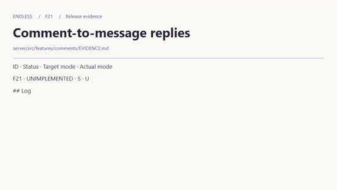](docs/pitch/recordings/f21.mp4)<br>[ดูแบบที่วางไว้](docs/pitch/recordings/f21.mp4) | [บันทึกฟีเจอร์](server/src/features/comments/EVIDENCE.md) |
| F22 · Live commerce และ product codes | [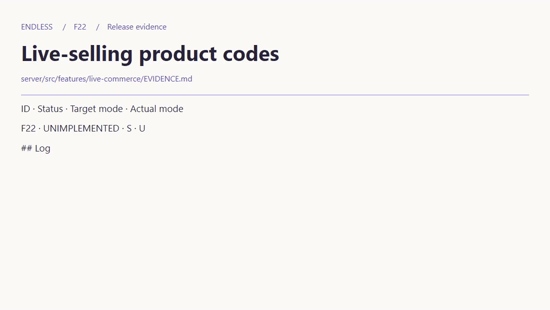](docs/pitch/recordings/f22.mp4)<br>[ดูแบบที่วางไว้](docs/pitch/recordings/f22.mp4) | [บันทึกฟีเจอร์](server/src/features/live-commerce/EVIDENCE.md) |
| F23 · Broadcast และ audiences | [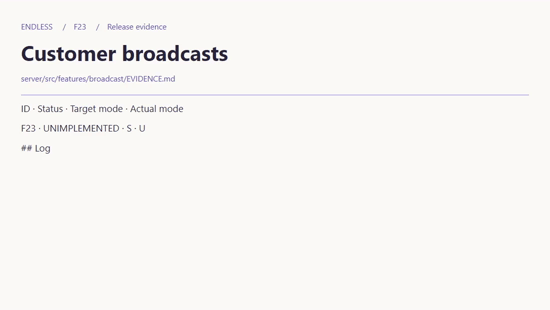](docs/pitch/recordings/f23.mp4)<br>[ดูแบบที่วางไว้](docs/pitch/recordings/f23.mp4) | [บันทึกฟีเจอร์](server/src/features/broadcast/EVIDENCE.md) |
| F24 · CRM และ tags automation | [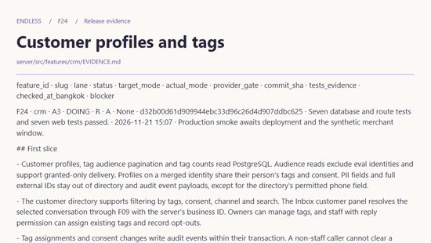](docs/pitch/recordings/f24.mp4)<br>[ดูหลักฐาน](docs/pitch/recordings/f24.mp4) | [บันทึกฟีเจอร์](server/src/features/crm/EVIDENCE.md) |
| F26 · Insights และ summaries | [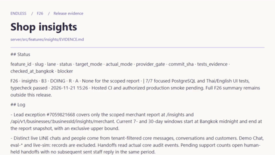](docs/pitch/recordings/f26.mp4)<br>[ดูแบบที่วางไว้](docs/pitch/recordings/f26.mp4) | [บันทึกฟีเจอร์](server/src/features/insights/EVIDENCE.md) |
| F27 · Dashboard usage/cost และ traces | [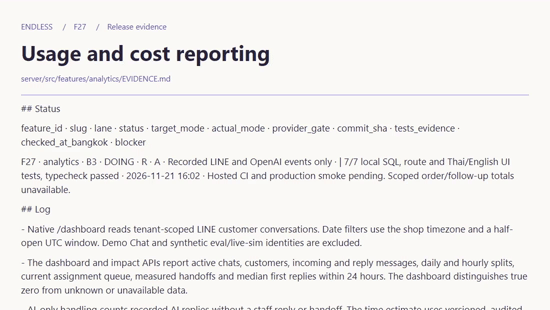](docs/pitch/recordings/f27.mp4)<br>[ดูแบบที่วางไว้](docs/pitch/recordings/f27.mp4) | [บันทึกฟีเจอร์](server/src/features/analytics/EVIDENCE.md) |
| F30 · Browser voice | [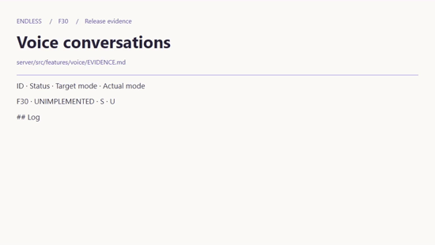](docs/pitch/recordings/f30.mp4)<br>[ดูแบบที่วางไว้](docs/pitch/recordings/f30.mp4) | [บันทึกฟีเจอร์](server/src/features/voice/EVIDENCE.md) |
| F31 · Notifications และ push | [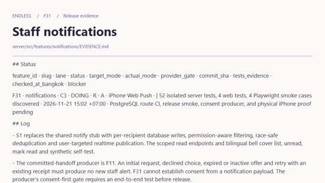](docs/pitch/recordings/f31.mp4)<br>[ดูหลักฐาน](docs/pitch/recordings/f31.mp4) | [บันทึกฟีเจอร์](server/src/features/notifications/EVIDENCE.md) |
| F35 · Reliability และเครื่องมือปฏิบัติการ | [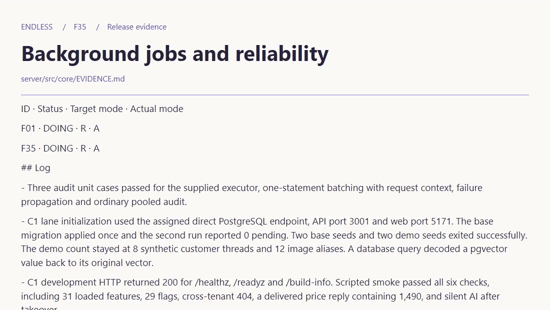](docs/pitch/recordings/f35.mp4)<br>[ดูหลักฐาน](docs/pitch/recordings/f35.mp4) | [บันทึกฟีเจอร์](server/src/core/EVIDENCE.md) |
| F36 · ตรวจรวม เผยแพร่ และหลักฐาน | [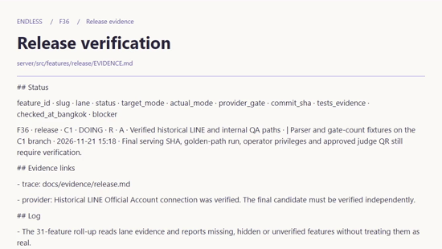](docs/pitch/recordings/f36.mp4)<br>[ดูหลักฐาน](docs/pitch/recordings/f36.mp4) | [บันทึกฟีเจอร์](server/src/features/release/EVIDENCE.md) |
| F37 · AI evals และหน้า AI quality | [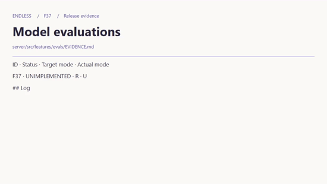](docs/pitch/recordings/f37.mp4)<br>[ดูแบบที่วางไว้](docs/pitch/recordings/f37.mp4) | [บันทึกฟีเจอร์](server/src/features/evals/EVIDENCE.md) |
| F38 · Follow-up nudges | [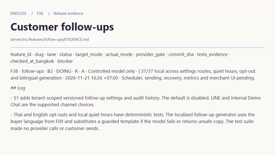](docs/pitch/recordings/f38.mp4)<br>[ดูแบบที่วางไว้](docs/pitch/recordings/f38.mp4) | [บันทึกฟีเจอร์](server/src/features/follow-ups/EVIDENCE.md) |
| F39 · ChatGPT-ready catalog (ACP feed + MCP) | [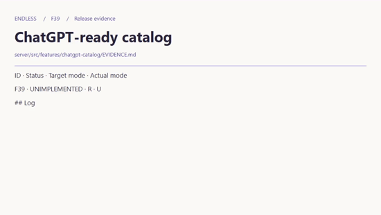](docs/pitch/recordings/f39.mp4)<br>[ดูแบบที่วางไว้](docs/pitch/recordings/f39.mp4) | [บันทึกฟีเจอร์](server/src/features/chatgpt-catalog/EVIDENCE.md) |

## เริ่มพัฒนาในเครื่อง

ใช้ Node.js 24 แล้วรันคำสั่งต่อไปนี้ใน worktree ที่ได้รับมอบหมาย

```sh
npm ci
npm run lane:init
npm run db:migrate
npm run db:seed
npm run dev
```

คำสั่ง lane:init เตรียมฐานข้อมูล PostgreSQL สำหรับพัฒนาและทดสอบของแต่ละทีม เก็บค่าลับไว้ในไฟล์ประจำเครื่องตาม[คู่มือตั้งค่า](prompts/C1-setup.md) เมื่อเริ่มเซิร์ฟเวอร์แล้ว ให้เปิด URL ของทีมและไปที่ `/dev-login` เพื่อเลือกบัญชีจำลองของเจ้าของร้านหรือพนักงาน จากนั้นตรวจโค้ดและรันชุดทดสอบด้วยคำสั่งด้านล่าง

```sh
npm run typecheck
npm test
npm run smoke
npm run e2e -- core
```

อ่านเพิ่มเติมใน[ภาพรวมผลิตภัณฑ์](docs/PRODUCT.md) [คู่มือนักพัฒนา](docs/COOKBOOK.md) และ[ขั้นตอนนำระบบขึ้นใช้งาน](docs/day/deployment.md)

## งานที่เตรียมไว้ก่อนเริ่มแข่งขัน

ก่อนเริ่มงาน ทีมเตรียมแผน ข้อกำหนดฟีเจอร์ สัญญาระหว่างโมดูลที่ประกาศเฉพาะชนิดข้อมูล สคริปต์บอร์ดทีม และการตั้งค่าเซสชัน Codex การเขียนตัวแอปสำหรับการแข่งขันเริ่มที่สาขา F01 setup เดโมและการทดสอบระหว่างพัฒนาใช้ข้อมูลจำลอง

## หลักฐานของรุ่นที่ตรวจ

ลูกค้าและกรรมการเข้าผ่าน LINE Official Account ของทีม ณ รุ่นที่บันทึก ทีมยังรอไฟล์ QR ที่อนุมัติแล้ว ส่วน Demo Chat ใช้ตรวจคุณภาพภายใน

สถานะด้านล่างอ้างอิง commit `926e5c09d7a723abe66adb5d532028b1cadece05`

0 R · 1 S · 17 A · 13 U

| รหัส | ฟีเจอร์ | สถานะ | หลักฐาน |
|---|---|---|---|
| F01 | ฐานโปรเจกต์และการรัน | A | [หลักฐาน](server/src/core/EVIDENCE.md) |
| F02 | ตัวตนและ session | A | [หลักฐาน](server/src/features/auth/EVIDENCE.md) |
| F03 | บัญชี ธุรกิจ สมาชิก และสิทธิ์ | A | [หลักฐาน](server/src/features/tenancy/EVIDENCE.md) |
| F04 | การตั้งค่าธุรกิจ | A | [หลักฐาน](server/src/features/business-settings/EVIDENCE.md) |
| F05 | คลังความรู้และวงจรข้อมูล | A | [หลักฐาน](server/src/features/knowledge/EVIDENCE.md) |
| F06 | นำเข้าและสกัดข้อมูล | A | [หลักฐาน](server/src/features/knowledge-import/EVIDENCE.md) |
| F07 | ค้นคืน RAG และประเมิน revision | A | [หลักฐาน](server/src/features/knowledge-search/EVIDENCE.md) |
| F08 | Catalog สินค้า/บริการ/variants | A | [หลักฐาน](server/src/features/catalog/EVIDENCE.md) |
| F09 | Inbox และประวัติ | A | [หลักฐาน](server/src/features/inbox/EVIDENCE.md) |
| F10 | AI turn และเครื่องมือ | A | [หลักฐาน](server/src/features/ai-agent/EVIDENCE.md) |
| F11 | ทีมและ human handoff | A | [หลักฐาน](server/src/features/team/EVIDENCE.md) |
| F12 | Rich messages และ templates | U | [หลักฐาน](server/src/features/message-templates/EVIDENCE.md) |
| F13 | Commerce และ orders | A | [หลักฐาน](server/src/features/orders/EVIDENCE.md) |
| F14 | QR การชำระและตรวจสลิป | A | [หลักฐาน](server/src/features/payments/EVIDENCE.md) |
| F15 | Booking และ reminders | U | [หลักฐาน](server/src/features/booking/EVIDENCE.md) |
| F16 | Google Calendar | U | [หลักฐาน](server/src/features/calendar/EVIDENCE.md) |
| F17 | LINE | S | [หลักฐาน](server/src/features/line/EVIDENCE.md) |
| F18 | Facebook และ Instagram | U | [หลักฐาน](server/src/features/meta/EVIDENCE.md) |
| F21 | Comment-to-DM | U | [หลักฐาน](server/src/features/comments/EVIDENCE.md) |
| F22 | Live commerce และ product codes | U | [หลักฐาน](server/src/features/live-commerce/EVIDENCE.md) |
| F23 | Broadcast และ audiences | U | [หลักฐาน](server/src/features/broadcast/EVIDENCE.md) |
| F24 | CRM และ tags automation | A | [หลักฐาน](server/src/features/crm/EVIDENCE.md) |
| F26 | Insights และ summaries | U | [หลักฐาน](server/src/features/insights/EVIDENCE.md) |
| F27 | Dashboard usage/cost และ traces | U | [หลักฐาน](server/src/features/analytics/EVIDENCE.md) |
| F30 | Browser voice | U | [หลักฐาน](server/src/features/voice/EVIDENCE.md) |
| F31 | Notifications และ push | A | [หลักฐาน](server/src/features/notifications/EVIDENCE.md) |
| F35 | Reliability และเครื่องมือปฏิบัติการ | A | [หลักฐาน](server/src/core/EVIDENCE.md) |
| F36 | ตรวจรวม เผยแพร่ และหลักฐาน | A | [หลักฐาน](server/src/features/release/EVIDENCE.md) |
| F37 | AI evals และหน้า AI quality | U | [หลักฐาน](server/src/features/evals/EVIDENCE.md) |
| F38 | Follow-up nudges | U | [หลักฐาน](server/src/features/follow-ups/EVIDENCE.md) |
| F39 | ChatGPT-ready catalog (ACP feed + MCP) | U | [หลักฐาน](server/src/features/chatgpt-catalog/EVIDENCE.md) |

R = ใช้งานจริง (Real) · S = ทดสอบใน Sandbox · A = เชื่อมต่อระดับ Adapter · U = ยังไม่พัฒนา

ณ จุดที่บันทึก ทีมรวม 112 pull requests มี 112 commits และเพิ่มโค้ดกับเอกสารรวม 72,249 บรรทัด
ยังไม่มีจำนวนผลทดสอบ Vitest ของรุ่นที่เตรียมส่ง
ยังไม่มีจำนวนผลทดสอบเส้นทางใช้งานหลักของรุ่นที่เตรียมส่ง

ดู[ทะเบียนฟีเจอร์](docs/FEATURE_STATUS.csv) [หลักฐานจากระบบจริง](docs/evidence/release.md) [ลำดับงานที่ใช้ Codex](docs/evidence/codex-timeline.md) และ[รายการตรวจงานก่อนส่ง](docs/submission/SUBMISSION.md)
