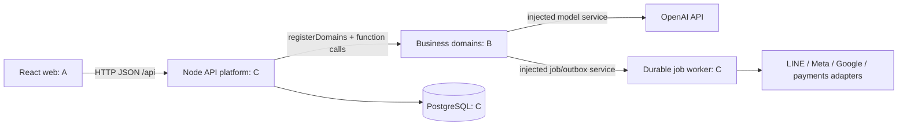

# ลำดับสร้าง Papi Nless ใหม่ครบระบบและการแบ่งงาน

> **อัปเดต 20 พ.ย. 2569:** [PLAN.md](../../PLAN.md) ฉบับ 20 พ.ย. แทนเอกสารนี้ทั้งหมด: ตัด F19 F20 F25 F28 F29 F32 F33 F34 ออกจาก scope (เหลือ 28 ฟีเจอร์ ใช้ได้ไม่จำกัด ไม่มีแพ็กเกจหรือโควตา), แบ่ง lane ใหม่ และ AI ของแอปใช้ OpenAI API อย่างเดียว เนื้อหาด้านล่างเป็นฉบับเก่าที่ไม่ได้แก้ตาม ถ้าขัดกับ PLAN ให้ยึด PLAN
>
> **อัปเดต 18 พ.ย. 2569:** การแบ่งงานในเอกสารนี้ถูกแทนที่ด้วย [PLAN.md](../../PLAN.md) (แบ่งตามฟีเจอร์ 3 คน × 3 lanes, ใช้โค้ด Papi เดิมเป็น reference, บอร์ด agent ผ่าน Codex hooks) ถ้าเนื้อหาขัดกับ PLAN.md ให้ยึด PLAN.md

เป้าหมายคือสร้างแอปใหม่จาก repository ที่ไม่มี implementation ของ Papi เดิม โดยครอบคลุมระบบใน [บัญชีความสามารถ](01-product-inventory.md) และ [backlog F01–F36](feature-backlog.csv) ภายในช่วงแข่งขัน 10:00–17:00 น. ทีมมีสามคนกับ Codex ของแต่ละคน แผนนี้จัดลำดับทุกระบบ ไม่ตัดระบบออกจากรายการ และไม่ถือว่าการทำครบชื่อเมนูเท่ากับทำครบพฤติกรรมหรือพร้อม production

เอกสารจัดทำวันที่ 17 พฤศจิกายน 2569 งานตามหน้าผู้จัดจัดวันเสาร์ 21 พฤศจิกายน 2569 เวลาไทย คำว่า “พร้อมเหมือนไปแข่งพรุ่งนี้” หมายถึงความพร้อมของคู่มือ ไม่ใช่การเปลี่ยนวันจัดงาน

## 1. นิยามผลงานที่ต้องสร้าง

คำว่า “ครบทุกระบบ” มีสามระดับที่ต้องบันทึกแยกกันในวันงาน:

1. **ความครอบคลุม:** ทุก subsystem มีแถวใน backlog และหน้า/route ที่สอดคล้องกัน ถ้าไม่สำเร็จต้องมีสถานะ `not-built` ห้ามซ่อนออกจากรายงาน
2. **การทำงาน:** มีข้อมูลถาวร authorization และ acceptance test ที่พิสูจน์พฤติกรรมได้ ไม่ใช่หน้า mock ที่กดแล้วแจ้งว่าสำเร็จ
3. **เชื่อม provider:** LINE, Meta, WhatsApp, Google, payment, email และ voice มีหลักฐานจาก provider test/live ที่ระบุโหมด ถ้าทำได้เฉพาะ adapter หรือ simulator ให้รายงานระดับนั้น

ระดับ `live-verified` ต้องมี credential ที่ถูกต้อง สิทธิ์จาก provider callback ที่ใช้งานได้ และ E2E จริง ระบบภายในพร้อมไม่ได้ทำให้การอนุมัติแอปหรือธุรกรรมจริงเกิดขึ้นโดยอัตโนมัติ เป้าหมายสูงสุดยังเป็นครบระบบ; ถ้าเวลาไม่พอให้เก็บทุกระบบในสถานะตามจริง แทนการอ้างว่าทำครบแล้ว

การเขียนใหม่ใช้ความรู้เรื่องปัญหาและพฤติกรรมเป็น reference ได้ แต่ไม่คัดลอก source, migrations, assets, database dump, credentials หรือแอบเรียก backend Papi เดิมขณะสาธิตว่าเริ่มจากศูนย์ เปิด API/model ของผู้ให้บริการภายนอกได้เมื่อประกาศ dependency ชัดเจน

## 2. รูปแบบแอปที่ทำให้แบ่งงานได้

ใช้หนึ่ง repository และหนึ่ง root `package.json`: React/TypeScript ใน `web/`, Node.js API ใน `server/`, PostgreSQL, background jobs/outbox และสัญญาข้อมูลใน `shared/` การทำ backend เป็นโมดูลไม่ต้องแยก Lambda ทุกฟีเจอร์ ไม่ต้อง publish npm packages



Domain ของ B ประกาศ route ผ่าน `registerDomains(router, services)` ที่ตกลงตั้งแต่ต้น ทำให้ C ไม่ต้องเขียน handler ของทุกฟีเจอร์ B ใช้ platform database/transaction abstraction ที่ C ให้ แต่ไม่แก้ pool, migration runner, session middleware หรือ worker scheduler เอง รายละเอียดที่ให้ Codex implement อยู่ใน [สถาปัตยกรรมและ contract](02-architecture-contracts.md)

## 3. เจ้าของคนและไฟล์

ชื่อ A/B/C คือบทบาท ให้ทีมแทนด้วยชื่อจริงและ GitHub login ก่อนเริ่ม ไม่มีการเดาว่าเพื่อนคนใดเชี่ยวชาญอะไร

| บทบาท | ขอบเขตที่เขียนได้ | รับผิดชอบผลลัพธ์ |
|---|---|---|
| A ประสบการณ์ผู้ใช้ | `web/src/**`, UI tests ในพื้นที่นี้ | app shell, forms/tables, routes ทุกระบบ, API client, loading/error/permission states, responsive, demo walkthrough |
| B กติกาธุรกิจและ AI | `server/src/domains/**`, `shared/features/**`, tests/fixtures ที่อยู่ข้าง module | domain CRUD handlers, AI tools, grounded facts, commerce/booking/CRM/channel domain, feature DTO และ `registerDomains` |
| C โครงระบบและผู้รวมงาน | `server/src/platform/**`, `server/src/index.ts`, `shared/base/**`, `migrations/**`, `tests/e2e/**`, root package/config/Docker/CI | auth/tenant enforcement, DB/transactions, durable jobs, model wrapper/budget, generic provider transport, build/test scripts, review/integration, release |

ให้คนที่คุ้นกับ Node/ฐานข้อมูล/แก้ integration มากที่สุดเป็น C คนที่รู้พฤติกรรมธุรกิจและ chatbot เป็น B คนที่ทำ React และสาธิตได้เร็วเป็น A ทุกคนช่วยออกแบบ test และทดสอบได้ แต่ไม่แก้พื้นที่ของคนอื่นโดยไม่ได้รับ handoff

ข้อยกเว้นต้องโพสต์ `HANDOFF REQUEST` บนบอร์ด ระบุไฟล์ งานที่ต้องเปลี่ยน และผลต่อ contract เจ้าของเดิมหรือหัวหน้าทีมอนุญาตก่อน จากนั้นเปลี่ยน owner ใน task ชั่วคราว เมื่อจบโพสต์ `HANDOFF RETURNED` ห้ามเพียงประกาศว่าจะแก้แล้วแก้ทันที

C มีงานหนาแน่นที่สุด จึงใช้ reusable authorization/transaction/job/route abstractions และให้ B เป็นเจ้าของ route ธุรกิจจริง A ช่วยเขียนรายการ E2E จากผู้ใช้ และ B ช่วยตรวจ domain integration แทนการเพิ่มภาระทุกอย่างให้ C

## 4. หน่วยงานที่ส่งให้ Codex

หนึ่ง task ต้องมี ID, owner, allowed paths, สิ่งที่พึ่งพา, input/output, acceptance, mode และคำสั่งตรวจ ตัวอย่าง:

```text
Task: F13-B-order-confirm
Owner: B
Allowed: server/src/domains/commerce/**, shared/features/commerce.ts
Depends: F03 tenant context, F08 catalog, F35 transaction/idempotency services
Build: draft quote -> explicit user confirm -> canonical price reload -> one order
Reject: forged tenant, stale quote, unavailable stock, reused idempotency key with changed payload
Deliver: implementation + colocated tests + commit + endpoint examples
Do not edit: migrations, package-lock, web, platform
```

อย่าโยนคำสั่ง “ทำ Nless ทั้งหมด” ให้ Codex ทั้งสามคนเหมือนกัน เพราะแต่ละคนจะสร้าง auth/router/schema/UI ซ้ำกัน ใช้ master brief ร่วมหนึ่งฉบับ แล้วมอบ task ตาม owner จาก [prompt pack](05-prompts.md)

## 5. สิ่งที่ทำก่อนวันงาน

1. อ่าน README และเลือก A/B/C พร้อม GitHub คนละบัญชี
2. ตกลงนิยามจากศูนย์ ขอบเขตทุกระบบ และ truth levels กับทีม ยึดกติกาผู้จัดสำหรับสิ่งที่ทำล่วงหน้าได้
3. เตรียมเครื่อง Node 24, Git, gh, editor/Codex, browser และ PostgreSQL ที่แยกจาก Papi production ตรวจด้วย `tools/preflight.ps1`
4. ตรวจ Docker CLI/engine ก่อนเลือก Docker mode: เครื่องที่ตรวจครั้งนี้ไม่พบ `docker` บน PATH ซึ่งยังไม่พิสูจน์ว่าไม่ได้ติดตั้ง ถ้าใช้ Docker ให้ติดตั้งและทดสอบก่อนงาน ถ้าไม่ใช้ ให้เตรียม PostgreSQL native/sandbox ที่มีอยู่แล้วและตรวจทั้งสามเครื่องตาม runbook
5. เตรียม credentials ของบัญชีทดสอบที่ทีมได้รับอนุญาต ไม่ใช่ของลูกค้าหรือ production; ตรวจ expiry, callback URLs, scopes และ model access โดยไม่เอาค่าลง Git
6. เตรียม CSV สังเคราะห์สองร้าน แต่ละร้านมีสินค้า บริการ ชั่วโมงทำการ policies และลูกค้าทดสอบ ให้มีสินค้าชื่อเหมือนกันต่างราคาเพื่อทดสอบ tenant isolation
7. เตรียม private repo สำหรับเอกสาร/บอร์ดและบัญชีเข้าถึงตาม [คู่มือ GitHub](04-github-board-codex.md) เปิดเผยว่าเครื่องมือประสานงานมีอยู่ก่อนการแข่งขัน
8. ก่อนอนุญาตเริ่มพัฒนา ห้ามสร้าง implementation ที่จะนำไปเคลมว่าเขียนในงาน เตรียม spec, contract, task, dependencies/tools และ practice แยกที่ไม่ส่งเข้า competition baseline
9. บันทึก baseline SHA และ tree ที่มีเพียงเอกสาร/เครื่องมือที่ประกาศไว้ บันทึกรายการ code/assets ที่มีมาก่อนอย่างตรงไปตรงมา

## 6. ลำดับที่ลงมือในเจ็ดชั่วโมง

ตารางต่อไปนี้เป็นเป้าหมายการจัดเวลา ไม่ใช่ผล benchmark หรือคำรับประกันว่าฟีเจอร์ทั้ง 36 กลุ่มจะผ่านในเวลานี้ งานแต่ละ wave ยังต้องผ่าน gate ก่อนใช้เป็นฐานของ wave ถัดไป รายการครบและ dependency ราย task อยู่ใน CSV

| เวลาไทย | A | B | C | Gate ที่ทีมต้องเห็น |
|---|---|---|---|---|
| 10:00–10:15 | อ่าน scope/contract; route matrix | อ่าน domain/backlog; DTO matrix | บันทึก start/baseline; ยืนยัน roles/provider modes | ทุกคนรู้ว่าตนแก้ไฟล์ใดและจะส่งอะไร |
| 10:15–10:45 | app shell/login/business selector/generic table-form | `registerDomains` และ DTO; business/catalog skeleton | root scripts, API, auth, DB, migration, tenant, health, CI skeleton | clean install/build; auth สองร้าน; `/health/ready` |
| 10:45–11:30 | knowledge/catalog/chat จาก fixture ไป API จริง | F05–F10 knowledge/catalog/search/AI read loop | model wrapper+usage, persisted chat/jobs/outbox, contract checks | รับ knowledge -> ถาม -> grounded answer พร้อม trace |
| 11:30–12:15 | order/booking/handoff UI | F11–F15 conversations/orders/payment-sandbox/booking | transaction/conflict/idempotency support; รวม wave แรก | order ยืนยันครั้งเดียว; booking กันชน; staff takeover |
| 12:15–13:00 | customers/tags/forms/insights/dashboard | F24–F27 + F31/F32, extraction jobs | quota hooks F28, notification/event support; integrated release | อ่านข้อมูลที่เพิ่งสร้าง; summary ไม่แต่งตัวเลข |
| 13:00–14:00 | channels/comments/live/broadcast UI | F16–F23 adapters/rules/templates/import/live codes | callback/signature transport/worker; provider test ที่พร้อม | live/test/sandbox ของแต่ละ adapterระบุชัด; duplicate webhook ไม่ส่งซ้ำ |
| 14:00–14:35 | billing/team/admin/legal/voice UI | F29/F30 domain; จบ feature gaps | auth/roles/admin F02–F04/F33/F34, billing test transport, audits | role/tenant tests ผ่าน; test payment/voice ตามโหมด |
| 14:35–15:15 | UX defects/mobile/recovery | domain failure cases/provider rejections | รวมทุก branch, migrations/checks, restart/worker recovery | feature ledger ทั้งหมดอัปเดต; no broken critical flow |
| 15:15–16:00 | ใช้ app จาก browser ใหม่; demo prep | ข้อมูลใหม่ unseen cases; evaluate AI | clean build of exact commit; sandbox deploy; regression gates | artifact SHA ตรง source; E2E ผ่านบน artifactจริง |
| 16:00–16:30 | จับเวลา/บันทึก demoและ backup | บันทึก model calls/cost + Codex evidence | fix เฉพาะ blocker; freeze candidate | ไม่มี mock ถูกเรียก live; เก็บผลทดสอบจริง |
| 16:30–17:00 | pitch/reviewคำพูด | ตรวจ README/truth ledger | ส่งผ่านช่องทางผู้จัด ตรวจ URL/commit/form receipt | ส่งก่อน freeze พร้อมทุกคนเปิด repoได้ |

F35 jobs/outbox และ F36 verification เป็นงานต่อเนื่องตั้งแต่เริ่ม ไม่ใช่งานที่รอถึงท้ายตาราง อาหารกลางวันเป็น working lunch ตามกำหนดการ แต่ต้องจัดพักสั้นสลับกันเพื่อไม่ให้ integration รอคนเดียว

## 7. วงจรรวมงานซ้ำทุก 30–45 นาที

1. A/B อ่านบอร์ดและ fetch ล่าสุดก่อนเริ่ม task ใหม่
2. ทำ task ใน branch ใหม่จาก `origin/demo`; รันทดสอบเฉพาะส่วนของตัวเอง
3. commit เฉพาะ allowed paths, push, เปิด PR ไป `demo` พร้อม test/mode/evidence
4. C อ่าน diff และรับผลตรวจอิสระตาม policy; ถ้า contract เปลี่ยนต้องแจ้งผู้ใช้ก่อน merge
5. C merge เฉพาะ head ที่ตรวจแล้ว ไม่ bypass checks ไม่ force push
6. C รัน integration gate และโพสต์ merge SHA/contract version บนบอร์ด
7. A/B รับ `origin/demo` ด้วยวิธีในคู่มือ Git แล้วเริ่ม task ต่อ; shared setup/lockfile ใช้รุ่นของ C

ห้ามรอ merge แรกถึงชั่วโมงที่หก ห้ามทั้งสามคนสั่ง Codex ทำงานใน shared folder เดียวกันพร้อมกันแล้วหวังว่าบอร์ดจะล็อกไฟล์ให้

## 8. ใช้ subagents อย่างคุ้มค่า

เริ่มด้วยหนึ่ง writer ต่อคน หลังโครงกลางทำงานแล้วค่อยเพิ่ม writer อีกหนึ่งเฉพาะ owner ย่อยที่แยกได้จริง เช่น A แบ่ง `web/src/features/knowledge/**` กับ `web/src/features/operations/**`; B แบ่ง commerce กับ CRM แต่ละ writer ต้องมี checkout/worktree และ task owner ของตัวเอง ถ้าใช้ shared checkout ให้ subagent ทำ read-only review/test analysis เท่านั้น

ตัวเลือกใน client และโควตาจริงอาจต่างกัน อย่าตั้งสมมติฐานว่าจะเปิดได้ไม่จำกัด แต่ละ subagent ใช้ tokens เพิ่ม จึงให้ผลลัพธ์เป็นสรุปไฟล์/ข้อผิดพลาดแทนการส่ง log ทั้งหมดกลับ main agent ไม่ให้ agent สร้างงานซ้ำเพียงเพราะอ่านบอร์ดไม่ทัน

## 9. เมื่อเวลาไม่เป็นไปตามแผน

| จุดตรวจ | ถ้าไม่ผ่าน | การเดินต่อที่รักษาเป้าหมายและความจริง |
|---|---|---|
| 10:45 health/auth/DB | setup กินเวลา | C หยุดงาน provider และแก้ foundation; A/B ทำงานจาก fixture contractเดิม |
| 11:30 knowledge-to-chat | model/RAGยังไม่ต่อ | ทดสอบ domainด้วยfake modelชั่วคราวและติดป้าย; แก้ modelจริงก่อนเคลม AIใช้งานได้ |
| 12:15 order/booking | duplicate/stale/conflict | ห้ามเปิด effect จริง; แสดง draftหรือblockไว้ แล้วใช้ C+Bแก้ invariantก่อน UIตกแต่ง |
| 14:00 external approvals | providerยังไม่พร้อม | เก็บadapter+signed fixtureเป็นsandbox; ห้ามแอบเรียกbackendPapiเดิมหรือสร้างconnectedbadge |
| 15:15 integrationยังแดง | ฟีเจอร์ครบชื่อแต่รันไม่ครบ | หยุดสร้างงานใหม่ทุกคน ไปแก้criticalflowร่วมกัน; ledgerเก็บรายการที่ยังไม่สำเร็จ |
| 16:30 artifactไม่เสถียร | deploy/เน็ตเสีย | กลับlast known good commitโดยไม่ลบDB; รันlocalที่ทดสอบแล้ว; ใช้backupvideoที่ระบุว่าrecorded |

รายการที่ยังไม่จบยังอยู่ในขอบเขต rebuild และ backlog เมื่อหยุดเวลา ไม่เปลี่ยนชื่อว่าทำครบแล้ว การรายงาน `not-built` ดีกว่าทำปุ่มที่ไม่มีผลแล้วนับเป็นฟีเจอร์เสร็จ

## 10. เงื่อนไขถือว่างานหนึ่งเสร็จ

มี handler และ UI ต่อจริง, schema/runtime validation, authorization/tenant filter, persisted state เมื่อควรมี, effect mode ชัด, acceptance ผ่าน, commitถูกpush/รวมและมีหลักฐาน ที่สำคัญหน้าสำเร็จต้องอ้างอิงผลที่บันทึกจริง ไม่ใช่คำที่โมเดลแต่ง ไม่ใช้จำนวนบรรทัด จำนวนเมนู หรือจำนวน prompt เป็นหลักฐานคุณภาพ

อ้างอิง: [กติกาและเวลาแข่งขัน](https://luma.com/39zve8ph), [Codex subagents](https://learn.chatgpt.com/docs/agent-configuration/subagents), [Git worktree](https://git-scm.com/docs/git-worktree), [Docker Compose](https://docs.docker.com/compose/gettingstarted/)
